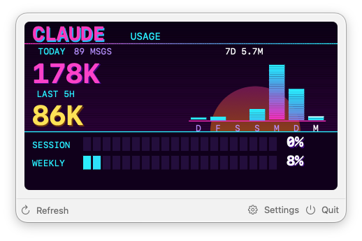
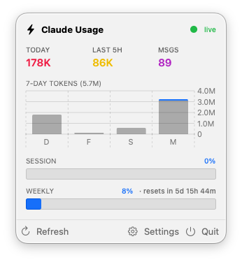

# ClaudeUsageBar

A macOS menu bar app that shows Claude Code usage — today's tokens, last-5-hours burn, message
count, and session/weekly limit gauges — right from the menu bar.

It both renders the data itself (two switchable dashboard styles) *and* drives the companion
[`espclaude`](espclaude) ESP32 hardware display over USB serial, so the same numbers can show up
on a physical gadget on your desk as well as in the menu bar.

| Synthwave style | Native style |
| --- | --- |
|  |  |

## What it does

- **Reads usage data natively in Swift** — scans `~/.claude/projects/**/*.jsonl` for token usage
  (bucketed into the last 7 days and last 5 hours), and calls the Claude usage-limits API for session (5h) / weekly (7d) percentages.
- **Shows it in the menu bar**, in a choice of two dashboard styles:
  - **Synthwave** — a neon grid/sun/bar-chart look, matching the ESP firmware's display.
  - **Native** — the same data as plain macOS UI (bar chart, gauges, stat tiles).
- **Connects to the ESP32 display over USB serial** — auto-detects the board's USB-device, configures it, and pushes the same usage data to it so the physical display stays in sync with the menu bar.

## Project layout

- [`macapp/`](macapp) — the Xcode/Swift source for ClaudeUsageBar. See
  [`macapp/README.md`](macapp/README.md) for build & run instructions.
- [`espclaude/`](espclaude) — the ESP32 firmware for the physical display.
- [`tools/`](tools) —  bare-bones Python scripts.

## Building & running

```bash
brew install xcodegen   # if not already installed
cd macapp
xcodegen generate
open ClaudeUsageBar.xcodeproj
```

Build & run from Xcode (⌘R). The app is menu-bar-only (no Dock icon) — look for the gauge icon.
Click it to open the usage panel, or use Settings to pick a dashboard style and USB device.
